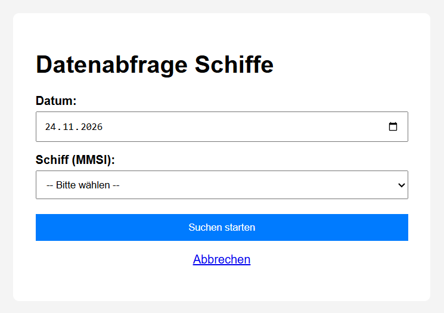
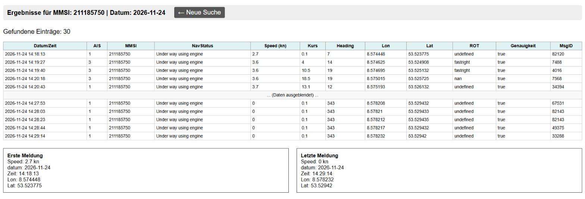
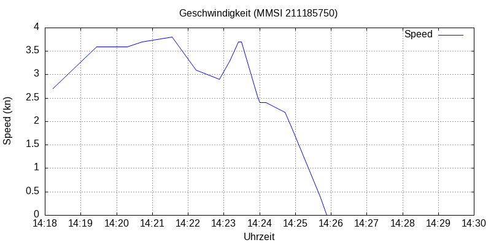

# Schiffsdaten-Abfrage

Eine kleine Web-Anwendung mit Bash und CGI. Man wählt ein Datum und ein Schiff aus
und bekommt eine Tabelle mit den AIS-Daten und ein Diagramm mit der Geschwindigkeit.

Wir haben das Projekt im Team an der Hochschule Bremerhaven gemacht.

## Bilder

Im Formular wählt man das Datum und das Schiff (MMSI).



Danach kommt eine Tabelle. Wenn es viele Einträge gibt, sieht man nur die ersten 5 und die letzten 5.
Unten steht die erste und die letzte Meldung von dem Tag.



Das Diagramm zeigt die Geschwindigkeit über die Zeit. Hier fährt ein Schiff langsamer und bleibt dann stehen.



## So funktioniert es

1. `CollectorDaten.sh` holt mit `ncat` die AIS-Daten vom Server `rhodes` und schreibt sie in `Log/aktueldaten.log`.
2. `watcher_rhodes.sh` läuft jede Minute mit cron. Wenn 3 Minuten keine Daten kommen, startet er den Collector neu.
3. `mmsi.sh` macht aus dem Log eine Liste mit allen Schiffen (`mmsi.csv`).
4. `auswahlform.sh` zeigt das Formular mit Datum und Schiff.
5. `ergebnis.sh` sucht die Daten, zeigt die Tabelle und ruft `plot.sh` auf.
6. `plot.sh` macht mit gnuplot das Diagramm.

Wenn keine MMSI gewählt ist oder das Datum in der Zukunft liegt, kommt eine Fehlermeldung.

## Ein Fehler, den ich später gefunden habe

Am Anfang ging das Diagramm bis 350 Knoten. So schnell fährt kein Schiff.
Wir hatten Feld 11 genommen, das ist aber der Kurs in Grad. Die Geschwindigkeit steht in Feld 7.
Auch die Spalten in der Tabelle waren verschoben. Jetzt stimmt es.

Außerdem konnte `www-data` die Bilder nicht schreiben. Jetzt schreibt `plot.sh` das Bild direkt in den Web-Ordner.

## Mein Teil

Wir waren ein Team. Ich war für den CGI-Teil zuständig, also für das Formular (`auswahlform.sh`),
die Ergebnisseite mit der Tabelle (`ergebnis.sh`) und das Diagramm (`plot.sh`).

## Ordner

```
CollectorDaten.sh   Daten von rhodes holen
watcher_rhodes.sh   Collector prüfen und neu starten
mmsi.sh             Liste der Schiffe machen
auswahlform.sh      Formular
ergebnis.sh         Tabelle und Diagramm
plot.sh             Diagramm mit gnuplot
beispiel/           20 Zeilen Beispieldaten
docs/               Bilder für dieses README
```

So sieht eine Zeile im Log aus:

```
2026-01-19 21:47:45|1|211537690|0|Under way using engine|nan|14.6|false|8.56581|53.539443|154.6|148|45|0|Not available|false|99985
```

## Starten

Man braucht Linux mit Apache2 (CGI an), gnuplot und ncat.

1. Die Skripte nach `/usr/lib/cgi-bin` kopieren.
2. In `plot.sh` den Web-Ordner für die Bilder anpassen. `www-data` muss dort schreiben dürfen.
3. Den Collector starten: `cd /usr/lib/cgi-bin && bash CollectorDaten.sh`
4. Den Watcher in die crontab eintragen: `* * * * * cd /usr/lib/cgi-bin && bash watcher_rhodes.sh`
5. Nach ein paar Minuten `mmsi.sh` laufen lassen und dann `auswahlform.sh` im Browser öffnen.
